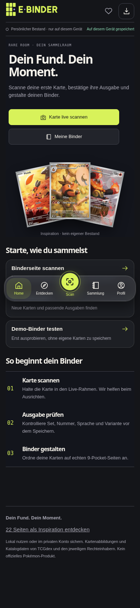
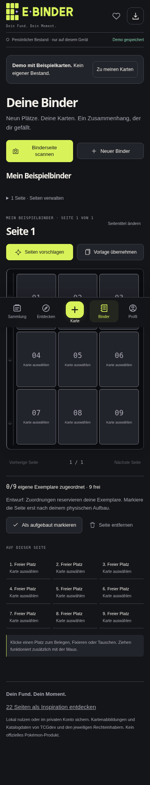
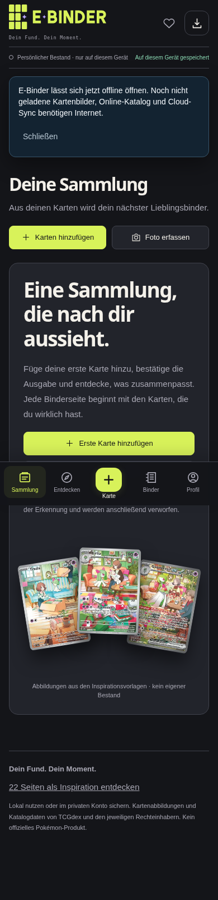
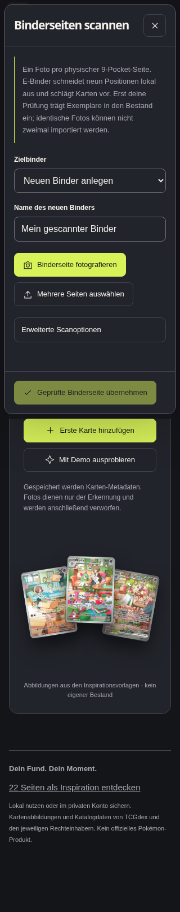

# E-Binder — Rare Room

**Deine Karten. Dein Binder. Dein Sammlermoment.**

Kostenlose, installierbare Pokémon-TCG-Web-App mit Live-Kartenscanner, 3×3-Binderseiten-Erfassung, Sammlungsverwaltung, Karten- und Set-Entdeckung sowie nachvollziehbaren Marktwerten.

[**E-Binder öffnen**](https://artursugarbear.github.io/E-Binder/) · [Vercel-Version (nach Freigabe)](https://e-binder-zeta.vercel.app) · [Beta-Guide](docs/beta-rollout.md) · [Produktreview](docs/reviews/2026-11-12-beta-release-readiness.md) · [Quality Hub – Live-QA](https://e-binder-quality-hub.vercel.app) · [Fehler melden](https://github.com/ArturSugarBear/E-Binder/issues)



|                          Dein Binder                          |                            Deine Sammlung                             |                       Live-Scanner                        |
| :-----------------------------------------------------------: | :-------------------------------------------------------------------: | :-------------------------------------------------------: |
|  |  |  |

> **Beta:** Die Erkennung ist eine Hilfe, keine Garantie. Set, Nummer, vollständigen Namen, Sprache, Holo-/Edition-Variante und Menge bewusst kontrollieren. Ein Scan erhöht niemals ungeprüft den Bestand.

## Warum E-Binder?

- **Ohne Konto starten:** Der lokale Bestand bleibt auf dem Gerät. Ein Konto synchronisiert private Bestands- und Binder-Metadaten optional.
- **Einfach scannen:** Eine Karte nach der anderen, mit weiterlaufender Kamera und lokalem Hintergrund-OCR. Mehrere offene Aufnahmen können später gemeinsam geprüft werden.
- **Neun Taschen auf einmal:** Binderseite aufnehmen, ausrichten und die einzelnen Taschen bewerten – erst nach ausdrücklicher Bestätigung speichern.
- **Exakte Ausgabe:** Deutsch, Englisch und Japanisch; Set, Sammlernummer, Name, Sprache und Variante vor Besitzübernahme vergleichen. Vintage-Editionen erfordern echte Stempelbestätigung.
- **Binder gestalten:** Individuelle Neun-Pocket-Seiten, Wünsche, Vorlagen und exportierbare JSONL-Sicherungen.
- **Marktwerte mit Quellen:** Cardmarket-EUR, klar getrennte TCGplayer-USD-Referenzen und gegebenenfalls datierte Währungsumrechnung. Nicht verfügbare Werte werden nicht erfunden.

## In drei Schritten zur Karte

1. **Aufnehmen:** Kamera oder lokale Datei auswählen.
2. **Prüfen:** OCR-Kandidaten und tatsächlich gedruckte Ausgabe vergleichen; bei Bedarf korrigieren.
3. **Bestätigen:** Erst deine Auswahl wird als Bestand übernommen.

PaddleOCR PP-OCRv4 mit ONNX Runtime arbeitet lokal im Browser. Unter **Profil → Visuelle KI · begrenzter Test** kann optional ein echtes DINOv2-ONNX-Bildmodell mit **nur neun geprüften deutschen Druckausgaben** getestet werden. Das ist kein universeller Fotoindex; für andere Karten bleibt OCR/Katalogsuche zuständig. Die Beta-Fotos trainieren die Gewichte noch nicht. [Grenzen und Testanleitung](docs/visual-beta-pilot.md).

## Mit deinen Beta-Scans die Erkennung verbessern

Die Teilnahme ist **standardmäßig aus**. Unter **Profil → Beta · Bilderkennung verbessern** gibt es eine separate, freiwillige Foto-Einwilligung – auch für Gäste ohne E-Binder-Konto. Nach ihrem Klick wird eine getrennte anonyme Testidentität für private Uploads angelegt; der lokale Bestand bleibt lokal.

Nur dann werden **neue** Fotos durch JPEG-Neukodierung ohne EXIF-/Standortdaten verkleinert und verschlüsselt in einen **privaten** Storage-Bucket geschickt. Die lokale OCR und dein Bestand funktionieren ohne Übertragung. Teilnahme stoppen und alle eigenen gespendeten Bilder löschen sind im Profil möglich. Bestätigte Kartenausgaben sind zunächst nur ungeprüfte Hinweise. Kein Foto und keine Nutzerbestätigung wird automatisch zu einem gültigen Trainingslabel. Bei null OCR-Treffern bleibt das aktuelle Foto erhalten, damit Set und Nummer oder der Name ohne neue Aufnahme nachgesucht werden können.

[Beta-Ablauf und Datenschutzgrenzen](docs/beta-rollout.md) · [Technisches Dataset-Konzept](docs/beta-dataset-pipeline.md)

## Gemeinsame Qualitätszentrale

[**E-Binder Quality Hub**](https://e-binder-quality-hub.vercel.app) zeigt Testfälle, Beta-Meldungen, Deploy-/PR-Stände und ein separates agentenfähiges QA-Protokoll. Gemeldete Fehler sind **nicht automatisch reproduziert oder als Regression bestätigt**. Private Scans, Zugangsdaten und Sammlungsinhalte gehören nicht in öffentliche QA-Einträge. [Anleitung für Tester und Agents](docs/quality-hub.md).

## Auf dem iPhone verwenden

In Safari [E-Binder](https://artursugarbear.github.io/E-Binder/) öffnen, **Teilen → Zum Home-Bildschirm** wählen. Die PWA verwendet lokal gecachte öffentliche Dateien; Cloud-Synchronisierung und aktuelle Preise benötigen Netzwerk.

## Entwickeln und verifizieren

Node.js **24** laut .nvmrc:

```sh
npm ci
npm run dev
npm run check
npx playwright install --with-deps chromium webkit
npm run test:e2e
```

GitHub Pages bleibt die aktive Produktionsversion. Nach Einrichtung der GitHub-Actions-Konfiguration kann die [abgesicherte Vercel-Pipeline](docs/vercel-auto-deploy.md) einen separat verifizierten Vercel-Release veröffentlichen. Der GitHub-Pages-Release wird durch Build, Unit-Tests und Chromium-/Mobile-/WebKit-Tests abgesichert. Ein Browser-Simulationstest ist kein Ersatz für echte iPhone-Kameratests.

| Thema                                    | Dokumentation                                                                                       |
| ---------------------------------------- | --------------------------------------------------------------------------------------------------- |
| Architektur, Daten und private Anmeldung | [Architektur](docs/architecture.md) · [Backend](docs/backend.md)                                    |
| Scannen, OCR und Sicherheit              | [Scanner](docs/scanner.md) · [Visuelle Erkennung](docs/p08-visual-retrieval.md)                     |
| Bedienkonzept und UI                     | [Design](docs/design.md) · [Referenz-Benchmark](docs/benchmarks/competitors/2026-11-10/ANALYSIS.md) |
| Foto-Benchmarks                          | [Scan-Qualität](docs/scanner-quality.md) · [Dataset-Audit](docs/dataset-audit.md)                   |
| Deployment und Regressionen              | [Deployment](docs/deployment.md) · [CI](.github/workflows/pages.yml)                                |

## Rechte und Grenzen

E-Binder ist ein unabhängiges Fan-/Sammlerprojekt. Pokémon-Marken und fremde Kartenbilder gehören ihren Rechteinhabern. Die Code-Lizenz überträgt keine Bild- oder Markenrechte. Katalog- und Marktdaten sind externe Referenzen und können fehlen oder veraltet sein. Private Nutzerfotos, Zugangsdaten und Supabase-Service-Role-Keys gehören niemals in öffentliche GitHub-Issues, Trainings-Repositories oder den Frontend-Build.
